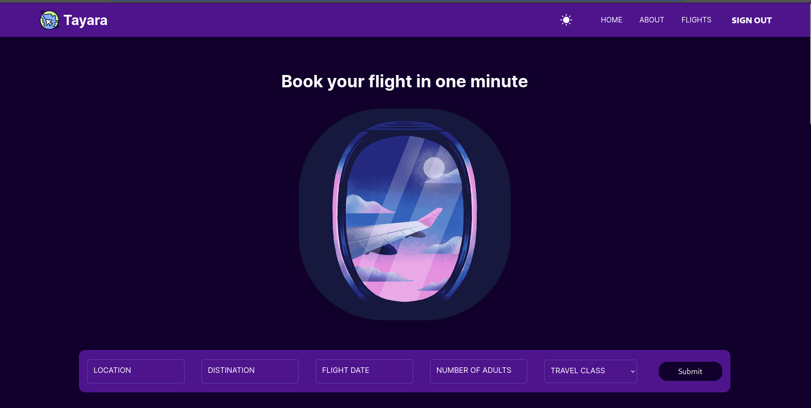

# About the Porject

A modern flight booking web application built with Next.js, Styled Components, GraphQL, Prisma ORM, and Redux. Integrates with Amadeus Travel API for flight data and IATA standards for airport/city codes.

## Features

-   **Flight Search & Booking**: Powered by Amadeus Travel API
-   **Airport/City Codes**: Standardized IATA codes integration
-   **Responsive Design**: Works on all device sizes
-   **Modern Stack**: Built with latest web technologies
-   **State Management**: Redux for global state
-   **Database**: Prisma ORM with PostgreSQL
-   **API**: GraphQL with Apollo Server

## Tech Stack

**Frontend:**

-   Next.js
-   Styled Components
-   Redux
-   Apollo Client

**Backend:**

-   Apollo Server
-   Prisma
-   PostgreSQL

**External APIs:**

-   [Amadeus Travel API](https://developers.amadeus.com/) - Flight search, booking, and pricing
-   IATA Standards - Airport/city codes and standards
